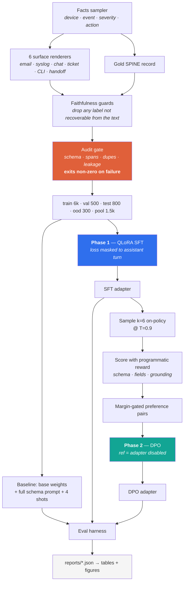
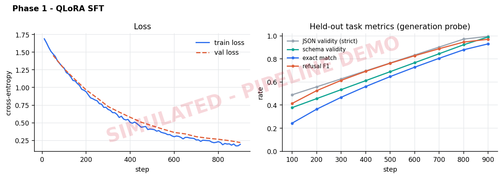
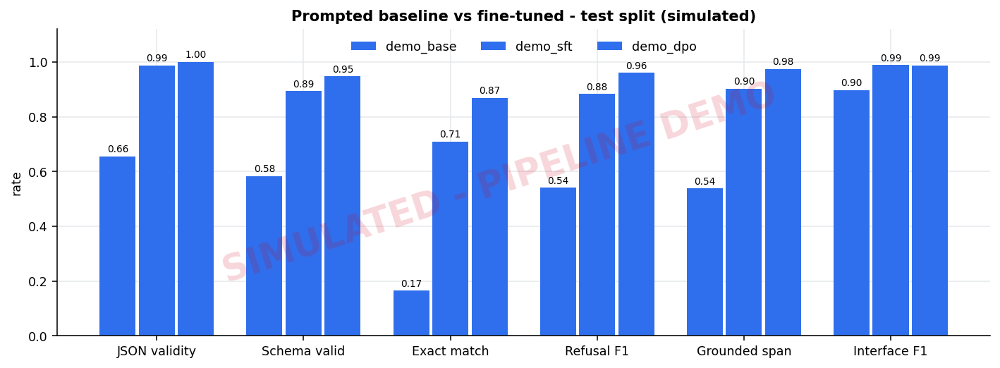

<h1 align="center">SPINE</h1>

<p align="center">
  <b>S</b>chema-constrained <b>P</b>reference-tuned <b>I</b>ncident <b>N</b>ote <b>E</b>xtractor
</p>

<p align="center">
  Two-phase post-training (QLoRA SFT &#8594; DPO) that turns messy network-operations text<br>
  into strict, schema-valid JSON &mdash; and knows when to refuse.
</p>

<p align="center">
  
  
  
  
  
  
</p>

---

## The problem

A NOC inbox is a firehose of free text: alert emails, syslog pastes, Slack messages,
half-finished ticket notes, shift-handover scribbles. Automation needs the same seven
fields out of every one of them. Prompting a strong general model gets you *most of the
way* — and then loses on the things that actually matter downstream: it wraps JSON in
prose, invents a `root_cause` key nobody asked for, writes `"CRITICAL"` where the schema
says `critical`, guesses a timestamp that appears nowhere in the input, and cheerfully
manufactures an incident out of a lunch-menu announcement.

Those are not intelligence failures. They are **consistency** failures, and consistency
is what fine-tuning buys.

This repository is a complete, runnable answer to that: a two-phase post-training
pipeline (supervised fine-tuning, then preference tuning), a metric suite that measures
the failures a JSON-validity check misses, and an honest baseline to beat.

> **Domain note.** The task is drawn from multi-vendor network operations — HPE Comware,
> Aruba AOS-CX, Cisco IOS, Junos, FortiOS — because interface naming, severity conventions
> and alarm phrasing genuinely differ per vendor, which makes normalisation a real problem
> rather than a toy one.

---

## What this project demonstrates

| Capability | Where to look |
|---|---|
| Parameter-efficient fine-tuning (QLoRA, NF4, 4-bit) on a single GPU | [`src/spine/train/sft.py`](src/spine/train/sft.py), [`configs/`](configs/) |
| Preference tuning with DPO, on-policy pair mining, KL-collapse guard | [`src/spine/train/dpo.py`](src/spine/train/dpo.py), [`src/spine/data/build_dpo.py`](src/spine/data/build_dpo.py) |
| Task design: a closed schema that makes "correct" machine-checkable | [`src/spine/schema.py`](src/spine/schema.py) |
| Data engineering: facts-first generation with a **failing** audit gate | [`src/spine/data/synth.py`](src/spine/data/synth.py), [`build_sft.py`](src/spine/data/build_sft.py) |
| Evaluation design beyond accuracy: refusal, grounding, per-field, sliced | [`src/spine/eval/metrics.py`](src/spine/eval/metrics.py) |
| Honest baselining — full-schema prompt + 4 exemplars, not a strawman | [`src/spine/prompts.py`](src/spine/prompts.py) |
| Reproducibility: config-driven runs, provenance capture, artifact-derived figures | [`src/spine/config.py`](src/spine/config.py), [`src/spine/viz/plots.py`](src/spine/viz/plots.py) |
| Debugging judgement | [`docs/TROUBLESHOOTING.md`](docs/TROUBLESHOOTING.md) |

---

## Pipeline



---

## Results

> **These are placeholders.** No GPU run has been executed against this repo yet.
> `make table` regenerates the table below straight from `reports/*.json` — every number
> in the documentation comes from an artifact, none is typed by hand.
> Full template and ablation list: **[`docs/RESULTS.md`](docs/RESULTS.md)**.

| Metric | Base + best prompt | Phase 1: SFT | Phase 2: SFT+DPO |
|---|---|---|---|
| JSON validity (no repair) | — | — | — |
| Schema valid | — | — | — |
| **Exact match (full record)** | — | — | — |
| Refusal F1 | — | — | — |
| Evidence span grounded | — | — | — |
| Prompt tokens / request | ~1,150 | **~30** | **~30** |

The last row is the one result that holds before any training: the prompted baseline
must carry the entire schema and four exemplars in *every single request*. The fine-tuned
model carries one instruction line, because the schema now lives in the weights. That is
a ~97% cut in prompt tokens per call — a serving-cost win that is independent of accuracy.

<details>
<summary><b>Pipeline demo figures</b> — proof the harness runs end to end, with simulated model outputs</summary>

<br>

`make demo` runs the entire measurement stack — metrics, slicing, reports, comparison
table, pair mining, figures — against three *simulated* models whose outputs are corrupted
gold labels. It exists so the plumbing is verified before a GPU is rented. The figures are
watermarked because they are **not** model results.




</details>

---

## Quickstart

```bash
git clone <your-fork> && cd spine
make setup-cpu          # ~30 s, no CUDA needed
make data               # generate the corpus + run the audit gate
make test               # 26 unit tests: schema, metrics, generator, audit
make demo               # end-to-end dry run of the eval stack, no model required
```

Everything above runs on a laptop in under two minutes. Then, on a GPU:

```bash
make setup
make smoke              # 3-min CPU check of the training code path (135M model)

make sft                # phase 1 — QLoRA, ~2.5 h on an A100-40GB
make eval-base          # honest baseline: base weights + full schema prompt + 4 shots
make eval-sft

make dpo-pairs          # sample k=6 on-policy, mine margin-gated preference pairs
make dpo                # phase 2
make eval-dpo
make eval-ood           # all three models on held-out surface styles

make figures table      # regenerate every figure and table from artifacts
```

Free-Colab path: swap in `SFT_CFG=configs/sft_qlora_t4.yaml DPO_CFG=configs/dpo_t4.yaml`
(Qwen2.5-1.5B, fp16, shorter sequences) — same code, same metrics, smaller envelope.
See [`notebooks/colab_quickstart.ipynb`](notebooks/colab_quickstart.ipynb).

---

## The task

The schema below is the spine of the project: the SFT targets, the DPO reward and
every evaluation metric are derived from it, so "correct" is machine-checkable at
every stage rather than a matter of judgement.

Input: one messy report. Output: exactly one JSON object, one of two shapes.

```jsonc
// an actionable incident
{"status": "incident", "incident": {
  "device_hostname": "sw-core-02",          // null if not stated
  "vendor": "hpe_comware",                  // closed vocabulary, 6 values
  "site": "chn-dc1",
  "interfaces": ["GigE1/0/24"],             // canonicalised across 5 vendor dialects
  "event_type": "link_down",                // closed vocabulary, 15 values
  "severity": "critical",                   // closed vocabulary, 5 values
  "started_at": "2025-03-11T08:42:10Z",     // UTC; local time + offset must be converted
  "ticket_id": "INC0044219",
  "affected_clients": 180,
  "action_required": "dispatch_field_engineer",
  "evidence_span": "GE1/0/24 went down"     // must be VERBATIM from the input
}}

// not an actionable incident — the refusal branch
{"status": "no_incident", "reason": "not_network_related"}
```

Three design decisions do most of the work:

**Closed vocabularies.** A free-text `severity` makes exact match meaningless and teaches
the model that `Critical`, `critical` and `CRIT` are all fine. They are not — the
downstream system has an enum.

**A verbatim `evidence_span`.** The cheapest possible grounding signal: a substring check.
No judge model, no API bill, and it turns "did it hallucinate?" into an assertion. It is
also what makes the DPO reward in phase 2 non-trivial.

**A refusal branch.** ~17% of the corpus is not an incident: HR announcements, planned
maintenance, resolved-notice duplicates, and reports too vague to act on. A model that
never abstains scores beautifully on the happy path and is useless in a real inbox.
Refusal is measured as a first-class metric, split into the two asymmetric errors —
*invented an incident* and *dropped a real one*.

---

## 1 · Data — where fine-tuning projects actually fail

There is no public "NOC free text → strict JSON" dataset, so the corpus is generated
**facts-first**: sample the ground truth, then render it into one of six messy surface
styles. The label is never parsed back out of the text, so it cannot inherit a regex bug.

Realism is injected deliberately: typos, forwarded-email headers, HTML remnants,
confidentiality footers, off-topic chatter, inconsistent casing, five vendor spellings of
the same interface, and local timestamps with real offsets that must be converted to UTC.

Then the corpus has to get past an **audit gate that exits non-zero**:

```
train  kept  6000 / 6000  dropped 0
       de-leaked 15 rows shared with train
val    kept   500 / 500   dropped 0
test   kept   800 / 800   dropped 0
ood    kept   300 / 300   dropped 0
       de-leaked 34 rows shared with train
pool   kept  1500 / 1500  dropped 0
leakage (shared input hashes): {'train_vs_val': 0, 'train_vs_test': 0, 'train_vs_ood': 0, 'train_vs_pool': 0}
```

The gate checks that every target is schema-valid, every `evidence_span` is verbatim,
exact duplicates are removed, near-duplicates are counted, and no input hash is shared
across splits. It caught real leakage on the first run — see
[issue #3](docs/TROUBLESHOOTING.md).

**The faithfulness guard is the part worth stealing.** A label is only written if it is
*recoverable from the input*. If the rendered text never shows the hostname, the gold
hostname becomes `null`. Around 6% of rows carried at least one unrecoverable field before
this guard existed; every one of them was an instruction to hallucinate, because inventing
a value was the only way to fit them.

### Splits

| Split | n | Purpose |
|---|---|---|
| `train` | 6,000 | SFT |
| `val` | 500 | early stopping + the in-training generation probe |
| `test` | 800 | headline metrics — disjoint entity pools |
| `ood` | 300 | **held-out surface styles** (`cli`, `handoff`) + disjoint abstain phrasings |
| `pool` | 1,500 | unseen prompts for on-policy DPO candidate sampling |

The `ood` split is the one that matters. It contains two rendering styles that appear
nowhere in training. The gap between `test` and `ood` is the honest measure of whether the
model learned the task or memorised the corpus.

---

## 2 · Phase 1 — Supervised fine-tuning (QLoRA)

Base weights in 4-bit NF4 with double quantisation; LoRA adapters (r=32, α=64) on all
attention **and MLP** projections. MLP inclusion is not cosmetic — attention-only adapters
train faster and underfit the closed-vocabulary enums.

Three things here are not boilerplate:

**Loss is masked to the assistant turn.** Training on prompt tokens too means a large share
of the gradient is spent learning to reproduce messy syslog, which is not the task. TRL's
`assistant_only_loss` handles it when the chat template emits ``, with a
completion-only collator as fallback. This is the difference between a model that emits
JSON and a model that autocompletes email signatures.

**A generation probe, not just eval loss.** Every `probe_every` steps a callback *generates*
on a held-out slice and logs JSON validity, schema validity, exact match and refusal F1.
Eval loss and task accuracy do not move together; a loss curve alone will tell you the run
is finished several epochs before exact match plateaus.

**Everything lands in a CSV.** `runs/sft/train_log.csv` → `spine.viz.plots` → the figures
in this README. No hand-plotting, no screenshots of a dashboard.

---

## 3 · Phase 2 — Preference tuning (DPO)

Phase 1 teaches the format. Phase 2 attacks what is left: the residual 
near-misses where the model produces valid JSON with one wrong enum, an ungrounded evidence
span, or a bad abstain call.

```
SFT adapter ──▶ sample k=6 @ T=0.9 on 1,500 unseen prompts
            ──▶ score every candidate with a dense programmatic reward
            ──▶ keep (best, worst) when margin ≥ 0.15
            ──▶ DPO, policy continues the SFT adapter, ref = adapter disabled
```

**On-policy.** Candidates come from the exact checkpoint DPO starts from. Pairs harvested
from another model teach the policy about a distribution it never visits.

**Programmatic, not vibes.** The gold label already exists, so the annotator is
`metrics.reward` — a weighted score over schema validity, per-field correctness, interface
F1 and span grounding. Dense, not binary: a binary judge makes almost every pair a tie
between two wrong answers and the preference signal collapses.

**Margin-gated and contrast-aware.** Pairs separated by a rounding error are noise, and DPO
will fit noise happily. Prompts where *every* sample is already perfect are skipped — no
contrast left to learn from. `reports/dpo_pairs.json` records the yield, the mean margin,
and a breakdown of *why* each rejected candidate lost (`prose_wrapped`, `extra_fields`,
`out_of_vocab_enum`, `ungrounded_evidence`, `wrong_field:severity`, …). A yield near 0% or
near 100% means the gates are miscalibrated, not that the model is perfect.

**A collapse guard.** Low β with a high learning rate is the classic DPO failure: both
`rewards/chosen` and `rewards/rejected` fall, the margin still grows, the loss looks
delighted, and the model degenerates. `CollapseGuard` watches for exactly that signature
and stops the run instead of burning the rest of the GPU budget.

**And then it is re-evaluated on the task.** DPO optimises a *relative* objective; it is
entirely possible to improve the preference loss and lose exact match. Only the eval
harness decides whether phase 2 ships.

---

## 4 · Evaluation

A single accuracy number hides where a model is failing, so the harness reports five
families:

| Family | Metrics | Why it exists |
|---|---|---|
| **Parseability** | strict JSON rate, repair rate, parse-mode histogram | A model that only passes after markdown-fence stripping is not production-ready. The repair rate falling to zero is a real result |
| **Schema validity** | key set, types, closed vocabularies, extra-key detection | `json.loads()` succeeding proves nothing about `"severity": "SUPER URGENT"` |
| **Content** | exact match, per-field accuracy, interface P/R/F1 | Shows *which* field is dragging the average down |
| **Refusal** | precision, recall, F1, missed-abstain, over-abstain | The two errors are asymmetric and must be reported separately |
| **Grounding** | verbatim `evidence_span` rate | Judge-free hallucination probe |

Everything is also **sliced by surface style and event type**, because a mean of 0.90 that
hides a 0.40 on handover notes is a report, not an insight. Every run writes an aggregate
JSON *and* a per-example JSONL with the wrong fields listed, so failures can be read
directly rather than guessed at.

**The baseline is deliberately strong.** `--prompt baseline` gives the base model the
complete schema, every vocabulary, all the normalisation rules, and four hand-built
exemplars covering an abstain case, a multi-interface case, a sparse case and a CLI paste.
Beating a one-line-prompt strawman would prove nothing.

---

## Repository layout

```
spine/
├── src/spine/
│   ├── schema.py              # the contract: enums, validation, normalisation, robust parsing
│   ├── prompts.py             # strong prompted baseline vs one-line SFT prompt
│   ├── config.py              # YAML configs, --set overrides, run provenance
│   ├── data/
│   │   ├── synth.py           # facts-first corpus generator + faithfulness guards
│   │   ├── build_sft.py       # audit gate: schema, spans, dupes, cross-split leakage
│   │   └── build_dpo.py       # on-policy candidate sampling → margin-gated pairs
│   ├── train/
│   │   ├── sft.py             # phase 1: QLoRA + CSV logger + generation probe
│   │   └── dpo.py             # phase 2: DPO + collapse guard
│   ├── eval/
│   │   ├── metrics.py         # the five metric families + the DPO reward
│   │   ├── run_eval.py        # harness: generate, score, slice, report
│   │   └── compare.py         # artifacts → markdown table
│   ├── infer/generate.py      # batched HF / vLLM generation behind one interface
│   └── viz/plots.py           # training curves, before/after, per-field
├── configs/                   # A100 · T4 · CPU-smoke · DPO
├── tests/                     # 26 tests — schema, metrics, generator, audit
├── scripts/pipeline_demo.py   # end-to-end dry run, no GPU
├── docs/                      # RESULTS · TROUBLESHOOTING · MODEL_CARD
└── Makefile                   # one target per pipeline stage
```

---

## Hardware envelope

| Setup | Base | Phase 1 | Notes |
|---|---|---|---|
| A100 40/80 GB | Qwen3-8B | ~2.5 h, 3 epochs | `configs/sft_qlora.yaml` |
| Colab T4 16 GB | Qwen2.5-1.5B | ~1.5 h | `configs/sft_qlora_t4.yaml` — `bf16: false`, Turing has none |
| CPU laptop | SmolLM2-135M | ~3 min | `configs/sft_smoke.yaml` — proves the code path, learns nothing |

The CPU tier is not a toy. Data generation, the audit, the full metric suite, the pair
miner's scoring logic, the figures and all 26 tests are pure-stdlib or matplotlib, so the
entire pipeline can be debugged before a GPU is rented — which is exactly how the six bugs
in [`docs/TROUBLESHOOTING.md`](docs/TROUBLESHOOTING.md) were found.

---

## Honest limitations

- **The corpus is synthetic.** Real NOC text is messier than any generator. The numbers
  here are an upper bound on real-world performance, not an estimate of it. The `ood`
  split narrows that gap; it does not close it.
- **The reward function is the annotator.** It is derived from gold labels, so DPO can only
  sharpen behaviours the labels already define. It cannot teach taste.
- **Closed vocabularies are a design choice with a cost.** The model cannot express an
  event type it has no label for, only `unknown`.
- **No human evaluation.** Every metric here is programmatic, which is what makes the
  project reproducible and also what caps what it can claim.

---

## Licence

MIT — see [`LICENSE`](LICENSE). Adapter weights inherit the base model's licence.
